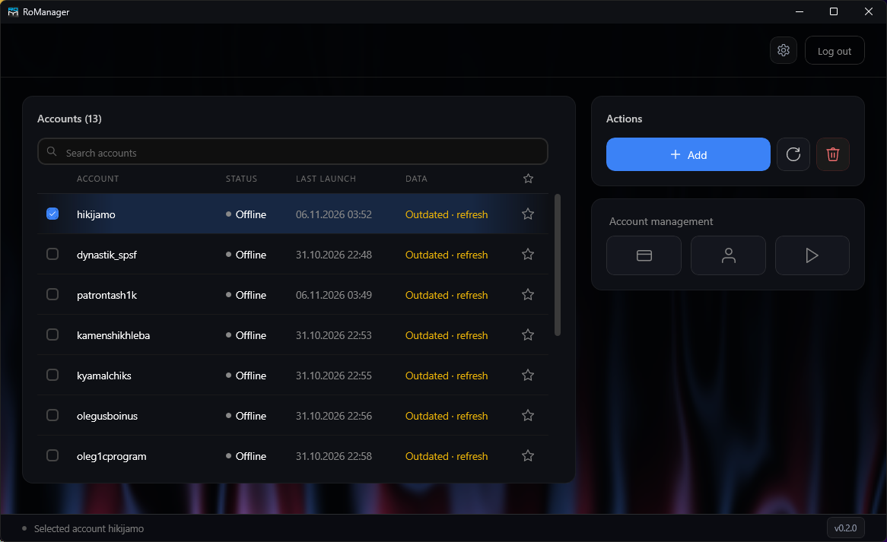

<p align="center">
  
</p>

<h1 align="center">RoManager</h1>

<p align="center">
  A modern Roblox account manager for Windows.<br>
  Encrypted vault, quick launching and a clean native interface.
</p>

<p align="center">
  <a href="https://github.com/as-des/RoManager/releases/latest"></a>
  
  
  <a href="LICENSE"></a>
</p>

<p align="center">
  <b>English</b> · <a href="README.ru.md">Русский</a>
</p>

> **Not affiliated with Roblox Corporation.** RoManager is an independent tool.
> It works only with your own accounts. Running multiple accounts at once may
> break the Roblox terms of service — use it at your own risk.

<p align="center">
  
</p>

## Features

### Accounts
- Keep all your accounts in one list with status, last launch and data freshness.
- Add accounts in seconds: sign in through a browser window or paste a cookie.
- **Favourites** are highlighted and always stay at the top of the list.
- **Search** by name and **sort** any column — click a header twice to reverse it.
- Multi-select for bulk actions: refresh, copy cookies, delete.

### Launching
- Start the Roblox launcher or a specific experience.
- Join a server by ID, or jump straight to a player by nickname.
- Run several clients at the same time and unlock the FPS cap.

### Security
- The vault is encrypted with a key derived from your key file, a two-word
  phrase and a PIN — you control all three.
- Remember-me keeps your sign-in protected for your Windows user only, with a
  configurable retention period. Turn it off or forget it at any time.
- Your Roblox password is never stored — only the session cookie, exactly like
  the official client.
- No telemetry. The app only talks to Roblox and never sends your data anywhere.

### Interface
- Native WinUI 3 with glass panels, smooth animations and a living shader
  background.
- English and Russian, switchable in Settings.
- Built-in changelog, About section and update check.

## Download

Grab the latest portable build from
[**Releases**](https://github.com/as-des/RoManager/releases/latest):

1. Download and unpack the archive anywhere you like.
2. Run `RoManager.exe`.
3. Create a new key file or open an existing one.
4. Add your accounts and you are ready to go.

No installer and no .NET installation required — the build is self-contained.
Keep the key file separate from the app folder for extra safety.

**Requirements:** Windows 10 x64 (1809+) or Windows 11, plus the Microsoft Edge
WebView2 Runtime (already present on Windows 11 and on Windows 10 with Edge).
Sign-in happens in an embedded browser, so no separate Chrome/Edge window is used.

## Build from source

You need the [.NET 8 SDK](https://dotnet.microsoft.com/download) and Windows 10/11 x64.

```powershell
dotnet build src\RoManager.App\RoManager.App.csproj -c Debug -p:Platform=x64
```

Self-contained build:

```powershell
dotnet publish src\RoManager.App\RoManager.App.csproj `
  -c Release -r win-x64 --self-contained true -p:Platform=x64 -o publish
```

The build produces WinUI resources (`resources.pri`) automatically, so no
Visual Studio Build Tools are required.

## Project layout

```text
src/
  RoManager.Core/   application logic and vault
  RoManager.App/    WinUI 3 interface
tools/              build helpers
docs/               development notes and images
```

## FAQ

**Does RoManager upload my accounts anywhere?**
No. Everything stays next to `RoManager.exe`; the app only talks to Roblox.

**Can I use it from a USB stick?**
Yes, the build is portable. Copy the folder, including the key file, and run it.

**Is there a Linux or macOS version?**
No, RoManager is Windows-only.

**Why do I need a key file and a phrase?**
Together with your PIN they unlock the encrypted vault. Without all three the
data cannot be read, even if someone copies the folder.

## Verify the release

Release archives are built and published by GitHub Actions from the tagged
commit, not from a developer machine. Every archive has a SHA-256 checksum in
`sha256sums.txt` and a signed build-provenance attestation.

```powershell
# 1. Compare the downloaded archive with the published checksum
Get-FileHash .\RoManager-win-x64-v0.02.zip -Algorithm SHA256

# 2. Check that the archive was built by this repository's workflow
gh attestation verify .\RoManager-win-x64-v0.02.zip -R as-des/RoManager
```

The archive also contains `build-info.txt` with the tag, commit SHA, source link
and the workflow run that produced it.

## Versioning

The current version is **0.2.0**. Earlier `pre-0.01` / `pre-0.02` releases are
from the first generation of the app; `v0.01` and later are the current
C# / WinUI 3 line. Full history is available in the changelog inside the app.

## License

[MIT](LICENSE) © 2026 as-des (asdes)

---

<p align="center">
  <sub>Made for people who juggle too many Roblox accounts.</sub><br>
  <sub><a href="https://github.com/as-des/RoManager">github.com/as-des/RoManager</a> · <a href="https://github.com/as-des/RoManager/issues">Issues</a></sub>
</p>
