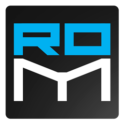

<div align="center">

<h1 align="center" style="line-height: 48px;">
  
  <span style="vertical-align: middle;">RoManager</span>
</h1>

**Roblox account manager for Windows**  
Encrypted storage, quick game launching, cookie management, and a modern UI on C# / WinUI 3.

<!-- Badges -->
[]()
[]()
[]()
[]()

> ⚠️ **Not affiliated with Roblox Corporation.** This application is not associated with Roblox and uses only public APIs and cookies from your own accounts. Multi-account automation may violate Roblox rules — use at your own risk.

</div>

---

## 📖 About the project

**RoManager** is a convenient app for managing multiple Roblox accounts. It allows you to securely store sessions, quickly switch between profiles, and launch the game in one click.

### ✨ Key features

<table>
  <tr>
    <td width="50%">
      <h4>👤 Accounts</h4>
      <ul>
        <li>Add accounts via built-in browser (Chrome/Edge, CDP) or by pasting <code>.ROBLOSECURITY</code> cookie.</li>
        <li>Multi-select, delete, and refresh data.</li>
        <li><b>Favorites:</b> star icon, gold highlight, and pinning to the top.</li>
        <li>Search by name and sort by any column.</li>
        <li>Online/offline status and last launch time.</li>
      </ul>
    </td>
    <td width="50%">
      <h4>🚀 Launching</h4>
      <ul>
        <li>Launch Roblox launcher or a specific game by <code>placeId</code>.</li>
        <li>Join server by ID and "Join player" by username.</li>
        <li>Multi Roblox (multiple clients simultaneously).</li>
        <li>FPS unlock.</li>
      </ul>
    </td>
  </tr>
  <tr>
    <td width="50%">
      <h4>🔐 Security</h4>
      <ul>
        <li>Storage is encrypted with <b>AES-256-GCM</b>, key derived via <b>PBKDF2-SHA256 (600,000 iterations)</b>.</li>
        <li>Supports legacy storage (AES-256-CBC).</li>
        <li><b>Session saving:</b> key file and auth code are encrypted with DPAPI (expires in 1–365 days).</li>
        <li>Roblox password is never stored — only cookies.</li>
      </ul>
    </td>
    <td width="50%">
      <h4>🎨 Interface</h4>
      <ul>
        <li>Native WinUI 3 with acrylic and animated background.</li>
        <li>GPU shader (HLSL via Win2D) with CPU fallback.</li>
        <li>Russian and English languages.</li>
        <li>Changelog and GitHub release checker.</li>
      </ul>
    </td>
  </tr>
</table>

---

## 📸 Screenshots

<!-- PLACEHOLDER: Replace with your screenshot link later -->
<div align="center">
  
  <br>
  <sub>Main Menu (Dashboard)</sub>
</div>

<br>

<!-- Place for second screenshot (if needed) -->
<!--
<div align="center">
  
  <br>
  <sub>App Settings</sub>
</div>
-->

---

## 🛠️ Requirements & Quick Start

### Requirements
- Windows 10 x64 (1809+) or Windows 11.
- Portable build **does not require** .NET or Windows App SDK installation.
- For browser login, Chrome or Edge is required (you can place a portable `chrome-win64` next to `RoManager.exe`).

### Quick Start
1. Download the release archive from [Releases](https://github.com/as-des/RoManager/releases) and extract it to any folder.
2. Run `RoManager.exe`.
3. Create a new key file or open an existing `.json` and enter your passphrase and PIN.
4. Add accounts using the "Add" button on the dashboard.

> 💡 All data is stored next to `RoManager.exe`. You can carry the folder on a flash drive; it is recommended to keep the key file separate from the storage.

---

## 📂 Data Files

| File | Purpose |
| :--- | :--- |
| `AccountData.json` | Encrypted account storage and settings |
| `AccountData.json.bak` | Backup of the previous state |
| `manager-session.json` | Saved session (DPAPI), if enabled |
| `shader.json` | Animated background settings |
| `ui.json` | Selected interface language |
| `rom.log` | Application log (rotates at 2 MB) |

*Files containing cookies, sessions, keys, and logs are intentionally excluded from Git.*

---

## 🧱 Building from Source

Requires [.NET 8 SDK](https://dotnet.microsoft.com/download) and Windows 10/11 x64.

```powershell
# Debug
dotnet build src\RoManager.App\RoManager.App.csproj -c Debug -p:Platform=x64

# Release / portable build
dotnet publish src\RoManager.App\RoManager.App.csproj `
  -c Release -r win-x64 --self-contained true -p:Platform=x64 -o publish
