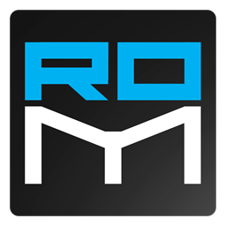
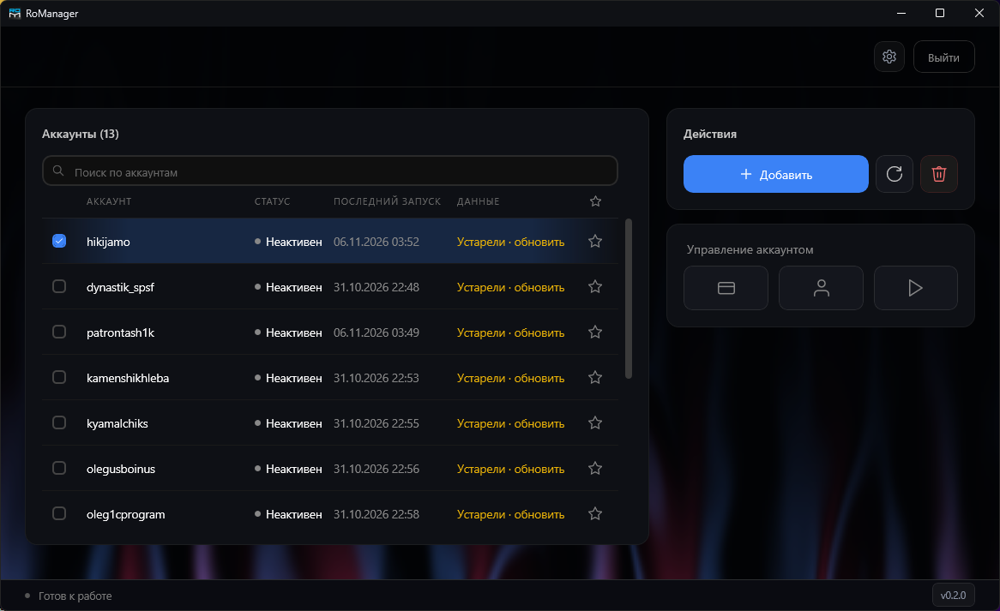

<p align="center">
  
</p>

<h1 align="center">RoManager</h1>

<p align="center">
  Современный менеджер аккаунтов Roblox для Windows.<br>
  Шифрованное хранилище, быстрый запуск и аккуратный нативный интерфейс.
</p>

<p align="center">
  <a href="https://github.com/as-des/RoManager/releases/latest"></a>
  
  
  <a href="LICENSE"></a>
</p>

<p align="center">
  <a href="README.md">English</a> · <b>Русский</b>
</p>

> **Не аффилировано с Roblox Corporation.** RoManager — независимый инструмент.
> Он работает только с вашими собственными аккаунтами. Одновременный запуск
> нескольких аккаунтов может нарушать правила Roblox — используйте на свой риск.

<p align="center">
  
</p>

## Возможности

### Аккаунты
- Все аккаунты в одном списке: статус, последний запуск и актуальность данных.
- Быстрое добавление: вход через окно браузера или вставка cookie.
- **Избранное** подсвечивается золотом и всегда остаётся в начале списка.
- **Поиск** по имени и **сортировка** по любому столбцу — повторный клик меняет
  направление.
- Множественное выделение для массовых действий: обновление, копирование cookie,
  удаление.

### Запуск
- Запуск лаунчера Roblox или конкретного плейса.
- Подключение к серверу по ID или сразу к игроку по нику.
- Несколько клиентов одновременно и разблокировка FPS.

### Безопасность
- Хранилище шифруется ключом, который выводится из вашего ключевого файла,
  фразы из двух слов и PIN — все три части под вашим контролем.
- «Запомнить меня» защищает данные входа для текущего пользователя Windows и
  имеет настраиваемый срок хранения. Функцию можно отключить, а сохранённые
  данные — удалить в любой момент.
- Пароль Roblox нигде не хранится — только cookie сессии, как в официальном
  клиенте.
- Никакой телеметрии. Приложение общается только с Roblox и никуда не отправляет
  ваши данные.

### Интерфейс
- Нативный WinUI 3: стеклянные панели, плавные анимации и живой шейдерный фон.
- Настраиваемое размытие фона и акцентный цвет: выберите любой акцент — кнопки, выделение, вкладки и подсветка обновятся сразу, без перезапуска.
- Шрифт Unbounded для заголовков и элементов управления, с полной поддержкой кириллицы.
- Русский и английский язык, переключается в настройках.
- Встроенная история обновлений, раздел «О программе» и проверка новых версий.

## Скачать

Последняя портативная сборка — в разделе
[**Releases**](https://github.com/as-des/RoManager/releases/latest):

1. Скачайте архив и распакуйте в любую папку.
2. Запустите `RoManager.exe`.
3. Создайте новый ключевой файл или откройте существующий.
4. Добавьте аккаунты — и можно пользоваться.

Установщик не нужен, .NET устанавливать не требуется: сборка самодостаточная.
Ключевой файл лучше держать отдельно от папки с программой.

В архиве рядом с `RoManager.exe` лежат файлы .NET-рантайма (несколько сотен
`.dll` и папка `Views`) — это нормально для портативной самодостаточной сборки.
Переносите или распаковывайте папку целиком, а не только `.exe`. В сборку
включены только русские и английские ресурсы интерфейса.

**Требования:** Windows 10 x64 (1809+) или Windows 11 и среда Microsoft Edge
WebView2 Runtime (уже есть в Windows 11 и в Windows 10 с Edge). Вход выполняется
во встроенном браузере, отдельное окно Chrome/Edge не открывается.

## Сборка из исходников

Нужен [.NET 8 SDK](https://dotnet.microsoft.com/download) и Windows 10/11 x64.

```powershell
dotnet build src\RoManager.App\RoManager.App.csproj -c Debug -p:Platform=x64
```

Самодостаточная сборка:

```powershell
dotnet publish src\RoManager.App\RoManager.App.csproj `
  -c Release -r win-x64 --self-contained true -p:Platform=x64 -o publish
```

Ресурсы WinUI (`resources.pri`) собираются автоматически, Visual Studio Build
Tools не нужны.

## Структура проекта

```text
src/
  RoManager.Core/   логика приложения и хранилище
  RoManager.App/    интерфейс WinUI 3
tools/              вспомогательные скрипты сборки
docs/               заметки по разработке и изображения
```

## Частые вопросы

**RoManager куда-то отправляет мои аккаунты?**
Нет. Всё хранится рядом с `RoManager.exe`, приложение общается только с Roblox.

**Можно носить на флешке?**
Да, сборка портативная. Скопируйте папку вместе с ключевым файлом и запускайте.

**Есть версия для Linux или macOS?**
Нет, RoManager работает только на Windows.

**Зачем нужны ключевой файл и фраза?**
Вместе с PIN они открывают зашифрованное хранилище. Без всех трёх частей данные
не прочитать, даже если кто-то скопирует папку.

## Проверка релиза

Архивы релизов собирает и публикует GitHub Actions из отмеченного тегом коммита,
а не с компьютера разработчика. У каждого архива есть контрольная сумма SHA-256 в
`sha256sums.txt` и подписанная аттестация происхождения сборки.

```powershell
# 1. Сравните скачанный архив с опубликованной контрольной суммой
Get-FileHash .\RoManager-win-x64-v0.03.zip -Algorithm SHA256

# 2. Убедитесь, что архив собран workflow этого репозитория
gh attestation verify .\RoManager-win-x64-v0.03.zip -R as-des/RoManager
```

Внутри архива лежит `build-info.txt` с тегом, SHA коммита, ссылкой на исходники
и номером запуска workflow, который собрал сборку.

## Версии

Текущая версия — **0.03** (тег релиза `v0.03`). Ранние релизы `pre-0.01` / `pre-0.02` относятся к
первому поколению приложения, `v0.01` и далее — текущая линейка на C# / WinUI 3.
Полная история доступна в changelog внутри приложения.

## Лицензия

[MIT](LICENSE) © 2026 as-des (asdes)

---

<p align="center">
  <sub>Для тех, у кого аккаунтов больше, чем времени.</sub><br>
  <sub><a href="https://github.com/as-des/RoManager">github.com/as-des/RoManager</a> · <a href="https://github.com/as-des/RoManager/issues">Issues</a></sub>
</p>
